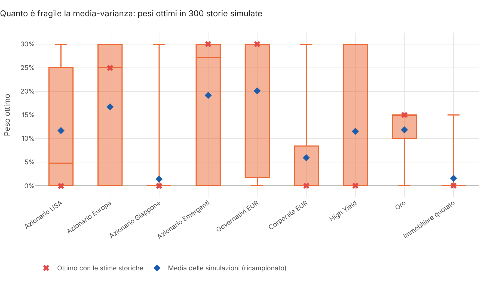
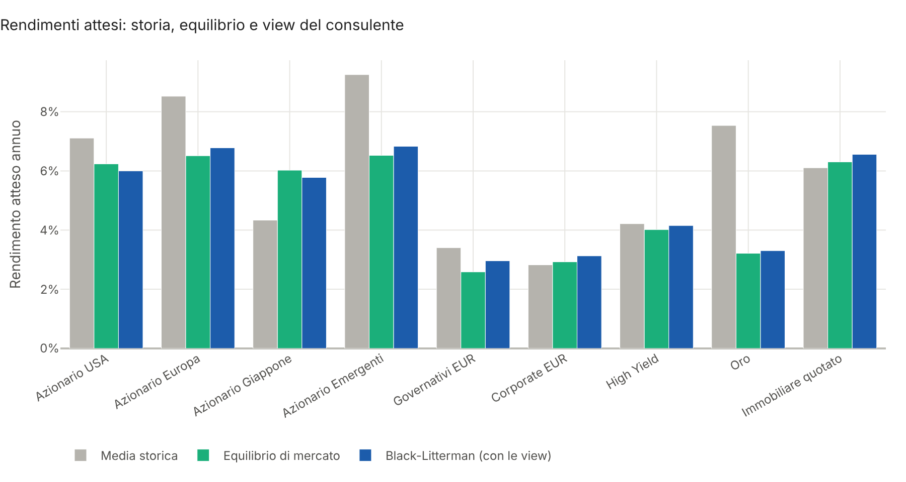
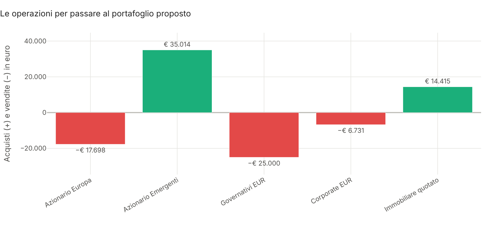
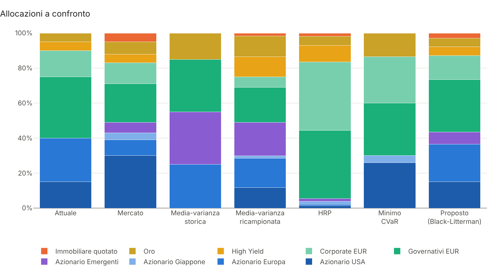
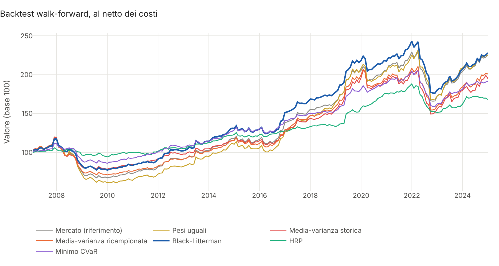
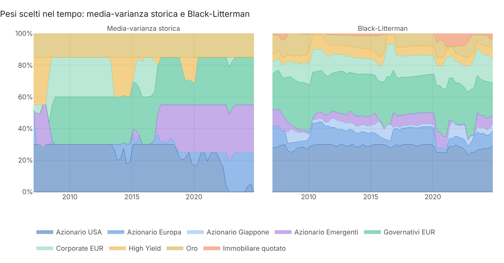

# Robust Allocation

**Allocazione robusta del portafoglio in Python: Black-Litterman con le view del consulente, Hierarchical Risk
Parity, minimo CVaR, frontiera ricampionata, vincoli di mandato, costi di transazione e backtest walk-forward.**

L'ottimizzazione di Markowitz è elegante sulla carta e fragile nella pratica: piccoli errori nei rendimenti attesi
producono portafogli concentrati, che cambiano radicalmente a ogni aggiornamento delle stime e generano costi. Il
progetto affronta le domande che un consulente si pone davvero prima di proporre un'allocazione: **come combino la
mia visione dei mercati con quella implicita nei prezzi? Quanto mi fido di ogni view? Quanto è stabile il
portafoglio ottimo? Quanto costa arrivarci dal portafoglio che il cliente ha già, e ne vale la pena?** Il risultato
è un **report HTML interattivo pronto da consegnare al cliente**, con la proposta di ribilanciamento in euro.



## Cosa fa

| Area | Contenuto |
|---|---|
| **Black-Litterman** | Rendimenti di **equilibrio** impliciti nei pesi di mercato, view **assolute** e **relative** del consulente, fiducia in percentuale con il metodo di **Idzorek** (in forma chiusa), media e covarianza a posteriori anche con view certe |
| **Ottimizzazione con vincoli reali** | Media-varianza con limiti per asset e per **classe di attività**, partenza dal **portafoglio attuale**, **costi di transazione** proporzionali e **limite di rotazione**, con acquisti e vendite come variabili esplicite (problema convesso, SLSQP con gradienti analitici) |
| **Robustezza** | Covarianza con **shrinkage di Ledoit-Wolf** verso la correlazione costante; **frontiera ricampionata** di Michaud con la distribuzione dei pesi ottimi su centinaia di storie simulate |
| **Hierarchical Risk Parity** | Clustering gerarchico sulla distanza di correlazione, quasi-diagonalizzazione e bisezione ricorsiva (López de Prado), con dendrogramma |
| **Minimo CVaR** | Programma lineare di **Rockafellar-Uryasev** sugli scenari storici (HiGHS), frontiera rendimento-CVaR, vincoli di mandato |
| **Backtest walk-forward** | Sette strategie ribilanciate ogni trimestre con i soli dati disponibili a quella data, deriva dei pesi, costi, rotazione e stabilità dei pesi; view di Black-Litterman generate in modo sistematico dal momentum |
| **Report** | HTML in italiano con 12 grafici interattivi Plotly, operazioni in euro, confronto dei metodi ed esito in linguaggio semplice |

Tutti i metodi sono scritti da zero su `numpy` e `scipy` (ottimizzazione, programmazione lineare, clustering),
senza librerie di portafoglio «a scatola chiusa», così ogni passaggio è verificabile. Tabelle `pandas`, grafici
`plotly`, report `jinja2`.

## Avvio rapido

```bash
git clone https://github.com/Torraf-MI/robust-allocation.git
cd robust-allocation
pip install -e ".[png]"

# Report con dati, view e portafoglio dimostrativi (circa un minuto con il backtest)
robust-allocation --demo --cliente "Famiglia Bianchi" --importo 500000

# Più veloce, senza backtest, utilizzabile anche offline
robust-allocation --demo --senza-backtest --offline

# Un cliente descritto in un file JSON: prezzi, mandato, portafoglio attuale e view
robust-allocation --config esempi/cliente.json --grafici output/img
```

Il report viene salvato in `output/report.html`. Un esempio già generato:
[`docs/report_esempio.html`](docs/report_esempio.html).

Il file JSON ([`esempi/cliente.json`](esempi/cliente.json)) contiene il percorso dei prezzi (CSV con una colonna di
date e una per strumento, giornalieri o mensili), i pesi di mercato, il portafoglio attuale, i vincoli per asset e
per classe, i costi, la rotazione massima e le view:

```json
"viste": [
  {"tipo": "relativa", "lunghi": ["Azionario Europa"], "corti": ["Azionario USA"], "rendimento": 0.015, "fiducia": 0.4},
  {"tipo": "assoluta", "asset": "Governativi EUR", "rendimento": 0.032, "fiducia": 0.6}
]
```

## Uso come libreria

```python
from robust_allocation import Ottimizzatore, Vincoli, Vista, hrp, minimo_cvar, modello, stima
from robust_allocation.dati import PESI_MERCATO, carica_csv, rendimenti

r = rendimenti(carica_csv("data/prezzi_esempio.csv"))
e = stima(r)                                     # media e covarianza Ledoit-Wolf, annualizzate

viste = [Vista("relativa", ["Azionario Europa"], 0.015, fiducia=0.4, corti=["Azionario USA"])]
bl = modello(e.covarianza, PESI_MERCATO, viste, avversione=2.5, risk_free=0.025)
print(bl.tabella_viste())                        # view indicata, implicita nell'equilibrio, a posteriori

vincoli = Vincoli(massimo=0.30, gruppi={"Azionario": (["Azionario USA", "Azionario Europa"], 0.3, 0.6)},
                  pesi_attuali=attuale, costi=0.0015, rotazione_massima=0.30)
proposto = Ottimizzatore(bl.posteriore, bl.covarianza, vincoli).media_varianza(avversione=2.5)
print(proposto.pesi, proposto.rotazione, proposto.costi)

print(hrp(e.covarianza).pesi)                    # Hierarchical Risk Parity
print(minimo_cvar(r, alfa=0.95).pesi)            # minimo CVaR sugli scenari storici
```

Esempio completo in [`examples/esempio.py`](examples/esempio.py).

## Risultati sull'esempio dimostrativo

Nove asset class (azionario USA, Europa, Giappone, emergenti; governativi, corporate e high yield in euro; oro;
immobiliare quotato), 23 anni di dati mensili simulati con le crisi del 2002, 2008, 2011, 2020 e lo shock
inflazionistico del 2022. Il cliente ha **€ 500.000** in un portafoglio tipico da banca italiana: 55%
obbligazionario, 40% azionario con forte peso sull'Europa, 5% oro. Il mandato prevede azionario tra 30% e 60%,
obbligazionario tra 30% e 60%, alternativi fino al 15% e nessun asset oltre il 30%.

**Le view del consulente.** Tre view con fiducia diversa: l'Europa farà meglio degli Stati Uniti di 1,5% all'anno
(fiducia 40%), i governativi in euro renderanno il 3,2% (60%), gli emergenti batteranno il Giappone di 2% (30%).
Black-Litterman le combina con l'equilibrio di mercato: lo scarto Europa-USA implicito nei prezzi era dello 0,3%
e a posteriori diventa 0,8%, il rendimento dei governativi passa dal 2,6% al 3,0%. Le view spostano le attese
senza sostituirle.



**La proposta.** Il portafoglio proposto alza il rendimento atteso dal 4,47% al 4,71% (volatilità dall'8,0%
all'8,9%) spostando solo il **9,9% del patrimonio**, con **€ 148 di costi**. Grazie alla penalità sui costi
l'ottimizzatore non tocca le posizioni il cui aggiustamento non ripagherebbe le commissioni: azionario USA, high
yield e oro restano dove sono. L'Europa scende comunque dal 25% al 21,5% nonostante la view favorevole, perché il
cliente ne aveva quasi il triplo del peso di mercato: la view riduce il taglio, non lo annulla.



**La fragilità della media-varianza classica.** Ripetendo l'ottimizzazione su 300 storie simulate compatibili con
le stesse stime, **ogni asset passa da zero al massimo consentito** a seconda della storia estratta (immagine in
alto). La media-varianza con le stime storiche mette il 30% negli emergenti e zero nelle obbligazioni societarie;
la versione ricampionata è molto più diversificata (6,7 asset effettivi contro 3,8).



**Backtest walk-forward dal 2007 al 2024**, ribilanciamento trimestrale, 15 punti base di costi:

| Strategia | Rendimento annuo | Volatilità | Sharpe | Massima perdita | Rotazione annua |
|---|---|---|---|---|---|
| Mercato (riferimento) | 4,6% | 9,5% | 0,22 | −42,4% | 8% |
| Pesi uguali | 4,6% | 10,6% | 0,20 | −49,0% | 9% |
| Media-varianza storica | 3,8% | 8,8% | 0,15 | −34,5% | 26% |
| Media-varianza ricampionata | 4,0% | 8,9% | 0,16 | −40,0% | 15% |
| **Black-Litterman** | **4,7%** | **8,6%** | **0,25** | **−34,1%** | **13%** |
| HRP | 2,9% | 4,9% | 0,09 | −19,5% | 9% |
| Minimo CVaR | 3,7% | 6,2% | 0,19 | −22,7% | 9% |



La media-varianza con le stime storiche ruota un quarto del portafoglio ogni anno e fa peggio del semplice
portafoglio di mercato: insegue i rendimenti passati. Black-Litterman, ancorato all'equilibrio e consapevole dei costi, ha lo
Sharpe più alto con metà della rotazione. HRP e minimo CVaR dimezzano la perdita massima: sono la scelta giusta per
chi dà priorità alla protezione, al prezzo di un rendimento più basso.



## Metodologia in breve

- **Covarianza**: Ledoit e Wolf (2004), shrinkage verso la matrice a correlazione costante con intensità ottimale
  stimata dai dati (qui il 7%).
- **Equilibrio**: π = δΣw<sub>mercato</sub>, con avversione al rischio δ = 2,5. Sono i rendimenti per cui il
  portafoglio di mercato sarebbe ottimo.
- **Black-Litterman**: μ = π + τΣP'(PτΣP' + Ω)⁻¹(Q − Pπ) e Σ<sub>post</sub> = Σ + τΣ − τΣP'(PτΣP' + Ω)⁻¹PτΣ, con
  τ = 0,05. Questa forma non inverte Ω e funziona anche con view certe.
- **Fiducia di Idzorek**: ωₖ = (1 − cₖ)/cₖ · pₖτΣpₖ' (Walters, 2011). Con fiducia c il portafoglio si sposta
  esattamente della frazione c verso quello che si avrebbe con la view certa; un test lo verifica.
- **Costi e rotazione**: w = w₀ + b − s con b, s ≥ 0, costo c·Σ(b + s) nell'obiettivo e ½Σ(b + s) ≤ rotazione
  massima. Il problema resta convesso.
- **Ricampionamento**: campioni gaussiani della stessa lunghezza dei dati, stima e ottimizzazione su ciascuno,
  media dei pesi (Michaud, 1998).
- **HRP**: distanza √(½(1 − ρ)), collegamento singolo, bisezione ricorsiva con varianza dei cluster a pesi
  inversi alla varianza (López de Prado, 2016).
- **Minimo CVaR**: min z + Σuₜ / ((1 − α)T) con uₜ ≥ −rₜ'w − z, uₜ ≥ 0 (Rockafellar e Uryasev, 2000).
- **Backtest**: finestra crescente con almeno cinque anni, decisione alla fine del mese e applicazione dal mese
  successivo, view di momentum a 12 mesi con fiducia del 25%, CVaR al 90% nelle finestre più brevi.

## Struttura

```
src/robust_allocation/
├── dati.py             # prezzi da CSV, rendimenti mensili, universo dimostrativo con regimi di crisi
├── stime.py            # media, covarianza con shrinkage di Ledoit-Wolf
├── black_litterman.py  # equilibrio, view, fiducia di Idzorek, posteriore, view di momentum
├── ottimizzatore.py    # media-varianza con vincoli, gruppi, costi e rotazione; frontiera
├── ricampionamento.py  # frontiera ricampionata di Michaud
├── hrp.py              # Hierarchical Risk Parity
├── cvar.py             # minimo CVaR e frontiera rendimento-CVaR (programmazione lineare)
├── backtest.py         # motore walk-forward e strategie
├── metriche.py         # rendimento, volatilità, drawdown, CVaR, diversificazione, contributi al rischio
├── analisi.py          # analisi completa e portafoglio proposto
├── configurazione.py   # esempio dimostrativo e lettura da JSON
├── report.py           # grafici Plotly e report HTML
├── cli.py              # riga di comando
└── templates/          # modello del report
data/                   # prezzi dimostrativi in CSV
esempi/                 # configurazione di un cliente in JSON
examples/               # uso come libreria
tests/                  # 38 test (pytest), eseguiti a ogni push con GitHub Actions
```

## Test

```bash
pip install -e ".[dev]"
pytest
```

I test verificano le proprietà matematiche di ogni metodo. Ledoit-Wolf lascia invariate le varianze e riduce lo
shrinkage quando i dati abbondano. Senza view Black-Litterman restituisce l'equilibrio e i pesi di mercato, una
view certa viene rispettata esattamente e con la fiducia di Idzorek i pesi si spostano esattamente della quota
indicata; con fiducia al 50% il metodo coincide con He-Litterman. L'ottimizzatore senza vincoli coincide con la
formula chiusa, rispetta limiti, gruppi e rotazione, e con costi molto alti non scambia nulla. HRP con covarianza
diagonale restituisce i pesi inversi alla varianza e divide a metà tra due blocchi identici. L'ottimo del
programma lineare coincide con il CVaR empirico del portafoglio ed è inferiore a quello di qualunque altro
portafoglio provato. Il ricampionamento è più diversificato della media-varianza. Il motore di backtest coincide
con un calcolo manuale, non usa dati futuri (alterare il futuro non cambia le decisioni passate) e i costi
riducono il rendimento. Infine report, configurazione JSON e riga di comando funzionano dall'inizio alla fine.

## Avvertenze

I dati dell'esempio sono **simulati**: le crisi ricalcano per date e ordine di grandezza episodi reali, ma i
numeri non sono quelli storici di alcun indice o strumento. Le view sono esempi, non raccomandazioni. I rendimenti
attesi sono stime incerte e il backtest non considera imposte né la liquidità degli strumenti; risultati passati o
simulati non garantiscono quelli futuri. Il progetto ha scopo dimostrativo e non costituisce consulenza
finanziaria.

## Licenza

MIT. Autore: Francesco Torraco.
